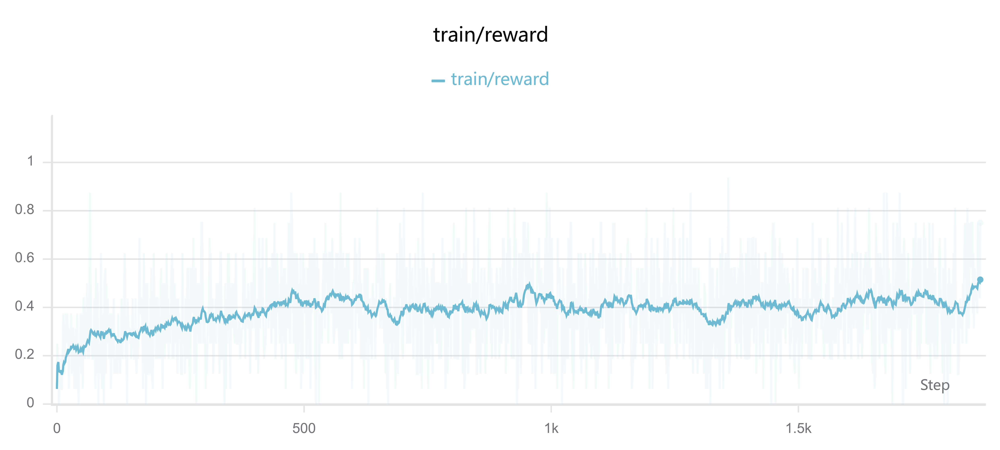
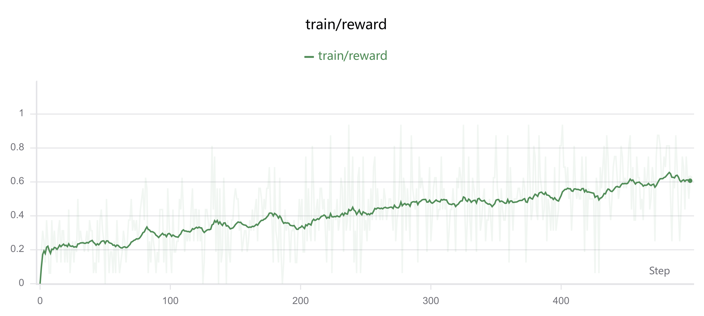
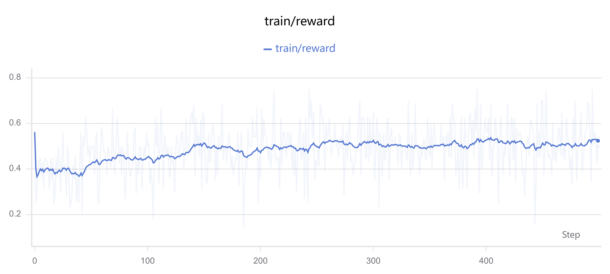

# LLM Reinforcement Learning on GSM8K

This repository is a learning-oriented exploration of reinforcement learning algorithms for large language models. It uses mathematical reasoning as a practical setting for understanding three policy optimization methods:

- **GRPO** — Group Relative Policy Optimization
- **GSPO** — Group Sequence Policy Optimization
- **DAPO** — Decoupled Clip and Dynamic Sampling Policy Optimization

The goal is to make the core ideas behind these algorithms easier to study through concise, readable implementations. Each method is implemented directly with PyTorch and applied to LoRA fine-tuning of [Qwen2.5-0.5B-Instruct](https://huggingface.co/Qwen/Qwen2.5-0.5B-Instruct) on [GSM8K](https://huggingface.co/datasets/openai/gsm8k). The code covers rollout generation, rule-based rewards, group-relative advantages, clipped policy objectives, evaluation, and experiment logging without relying on a high-level RL training framework.

## Highlights

- Minimal PyTorch implementations of GRPO, GSPO, and DAPO-style training
- Parameter-efficient fine-tuning with LoRA
- Grouped response sampling and within-group advantage normalization
- One-shot prompting with a consistent `#### <number>` answer format
- Full GSM8K test-set evaluation after training
- Training metrics logged to [SwanLab](https://swanlab.cn/)
- Saved LoRA adapters that can be evaluated directly

## Algorithm Overview

| Method | Policy ratio | Clipping | Additional behavior |
| --- | --- | --- | --- |
| GRPO | Token-level | Symmetric | — |
| GSPO | Sequence-level | Asymmetric | Uses the mean of token-level importance ratios for each completion |
| DAPO | Token-level | Asymmetric | Discards groups whose sampled answers are all correct or all incorrect, and applies a soft overlong-response penalty |

All methods sample multiple completions for each question and normalize rewards within each group. This produces a relative advantage signal without training a separate value model.

## Results

The saved adapters in this repository produced the following greedy-decoding accuracy on the full GSM8K test split:

| Method | Training budget used | Test accuracy | Adapter directory |
| --- | --- | ---: | --- |
| Base model | No RL training | 16.60% | — |
| GRPO | One epoch over the full training split | 47.16% | `grpo_gsm8k_lora/` |
| GSPO | 500 steps | 48.37% | `gspo_gsm8k_lora/` |
| DAPO | 500 steps | 49.73% | `dapo_gsm8k_lora/` |

GRPO was trained on the entire GSM8K training split, whereas the recorded GSPO and DAPO experiments were stopped after 500 steps. Their final accuracies should therefore not be treated as a strictly controlled comparison under equal training budgets.

### Training Reward Curves

The following SwanLab plots show the step-level training reward and its smoothed trend for each recorded experiment.

#### GRPO



#### GSPO



#### DAPO



## Project Structure

```text
.
├── GRPO.py                    # GRPO
├── GSPO.py                    # GSPO
├── DAPO.py                    # DAPO
├── utils.py                   # Prompting, rewards, rollouts, log-probabilities, evaluation
├── test_basemodel.py          # Evaluation of the base model
├── test_trained.py            # Evaluation of a saved LoRA adapter
├── test_prompt.py             # Inspection of the rendered chat prompt
├── requirements.txt
├── exp_result/                # Training reward curves 
├── grpo_gsm8k_lora/           # Saved GRPO adapter and evaluation result
├── gspo_gsm8k_lora/           # Saved GSPO adapter and evaluation result
└── dapo_gsm8k_lora/           # Saved DAPO adapter and evaluation result
```

## Installation

Clone the repository, create a virtual environment, and install the pinned dependencies:

```bash
git clone <repository-url>
cd llm-RL

python -m venv .venv
```

Install the dependencies:

```bash
python -m pip install -r requirements.txt
```

### Cache the model and dataset

Every executable script sets `HF_HUB_OFFLINE=1`. The base model and GSM8K dataset must therefore already exist in the local Hugging Face cache. On a machine with network access, cache them once before running this project:

```bash
python -c "from transformers import AutoTokenizer, AutoModelForCausalLM; name='Qwen/Qwen2.5-0.5B-Instruct'; AutoTokenizer.from_pretrained(name); AutoModelForCausalLM.from_pretrained(name)"
python -c "from datasets import load_dataset; load_dataset('openai/gsm8k', 'main')"
```

If you prefer online loading, remove or change the following line in the relevant Python scripts:

```python
os.environ["HF_HUB_OFFLINE"] = "1"
```

Training also initializes a SwanLab run. Configure SwanLab authentication before training if your environment requires it.

## Usage

### Evaluate the base model

Evaluate 32 randomly selected test questions using batched inference:

```bash
python test_basemodel.py 32 --batch_size 16
```

### Train an adapter

Run one of the training scripts from the repository root:

```bash
python GRPO.py
```

### Evaluate a trained adapter

Evaluate a saved adapter on ten random GSM8K test questions:

```bash
python test_trained.py 10 --adapter grpo_gsm8k_lora
```

## Default Training Configuration

All three methods use the following shared defaults:

- Base model: `Qwen/Qwen2.5-0.5B-Instruct`
- Dataset: `openai/gsm8k`
- Group size: 4 completions per question
- Prompt batch size: 4 questions
- Micro-batch size: 4 completions
- Learning rate: `1e-5`
- Sampling temperature: `1.0`
- Top-p: `1.0`
- Gradient clipping: `1.0`
- LoRA rank/alpha: `16/32`
- LoRA targets: attention projections and MLP projections

Method-specific defaults remain in each script so that the implementation and its configuration can be read together.

## Reward and Answer Format

The prompt asks the model to place its final numerical answer on a separate line:

```text
#### <number>
```

The reward is `1.0` when the extracted number exactly matches the normalized reference answer and `0.0` otherwise.

## Limitations

- The reported accuracy is sensitive to answer formatting. The evaluator prioritizes answers written as `#### <number>`. As a result, the base model's measured accuracy of 16.60% may underestimate its actual problem-solving ability: a correct final answer written in another format, such as `**16**`, can be marked incorrect.
- Each rollout batch is used for only one policy update instead of being reused for multiple optimization epochs. The old and new log-probabilities are therefore computed before any parameter update, making their importance ratio effectively `1`. Consequently, the recorded `clip_frac` remains `0` throughout training and does not meaningfully reflect the clipping behavior of the objectives.
- The implementations prioritize clarity over distributed training, maximum throughput, and exact paper reproduction.
